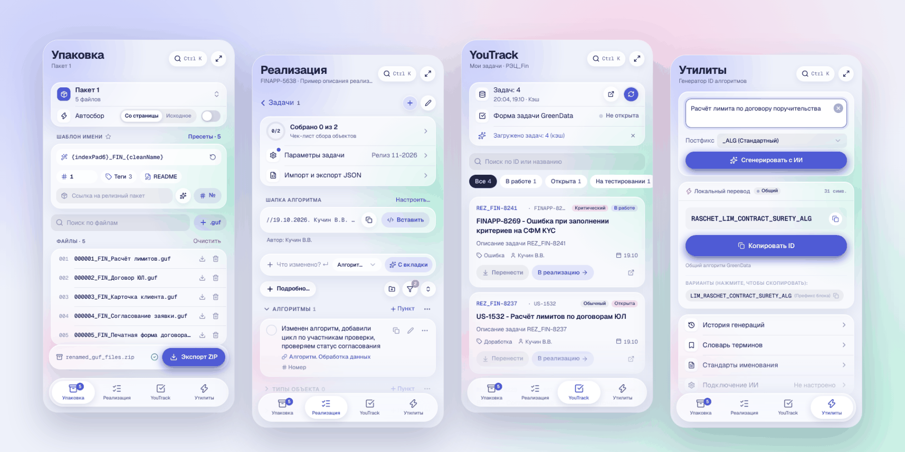
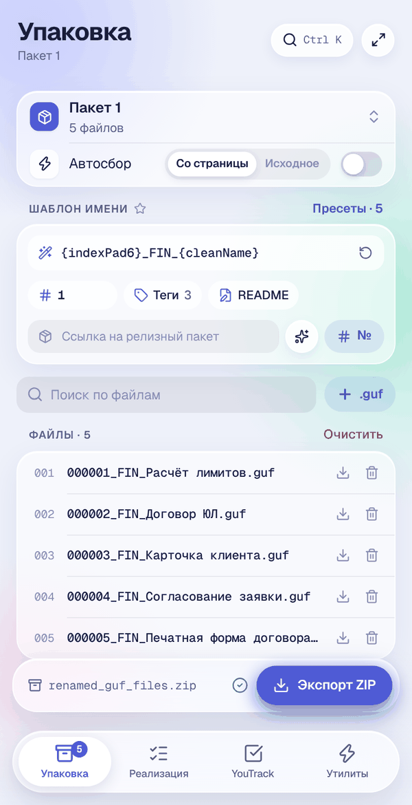
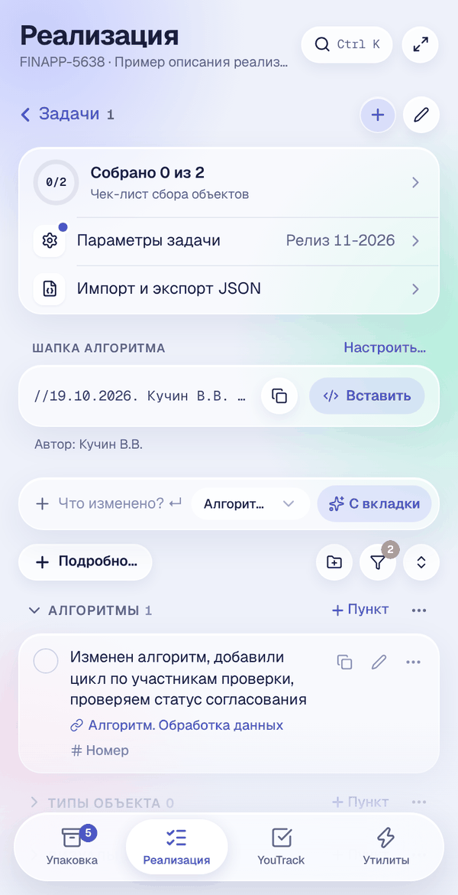
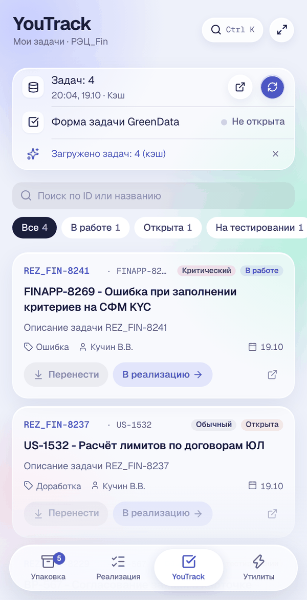
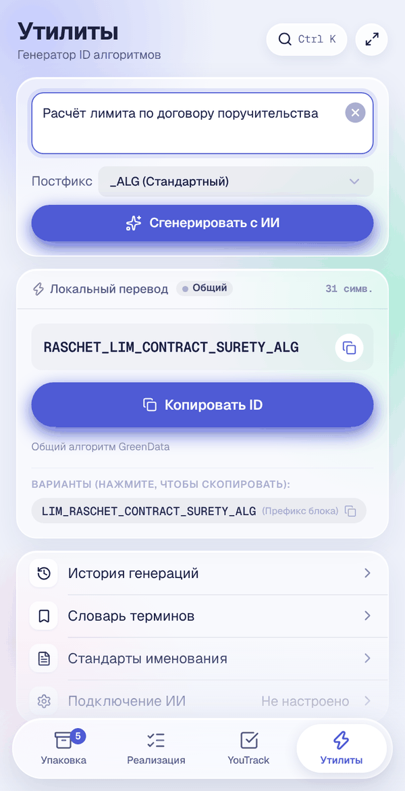
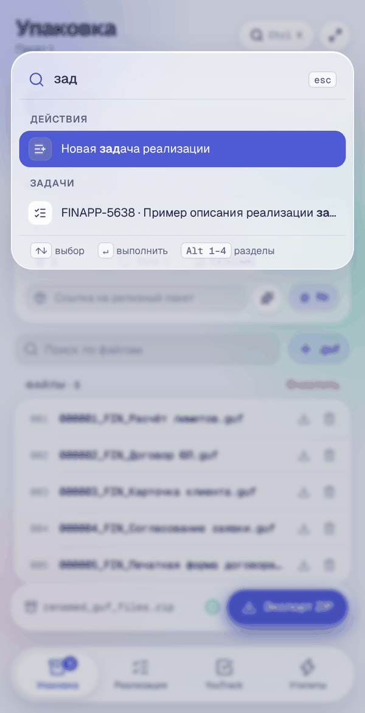

<div align="center">


# GD Helper

**Боковая панель Chrome для разработчиков на платформе GreenData**

Упаковка обновлений `.guf`, ведение реализации задач, задачи YouTrack и генератор ID алгоритмов — в одном окне рядом с порталом.




</div>

---

## Содержание

- [Возможности](#возможности)
  - [Упаковка](#-упаковка)
  - [Реализация](#-реализация)
  - [YouTrack](#-youtrack)
  - [Утилиты](#-утилиты)
  - [Командная палитра и горячие клавиши](#-командная-палитра-и-горячие-клавиши)
- [Установка](#установка)
- [Разработка](#разработка)
- [Структура проекта](#структура-проекта)
- [Разрешения и данные](#разрешения-и-данные)
- [Документация](#документация)

---

## Возможности

### 📦 Упаковка



Сборка релизного ZIP-архива из выгрузок `.guf` с единообразными именами.

- **Пакеты** — несколько независимых наборов файлов: создание, дублирование, переименование, быстрый переход между ними.
- **Автосбор** — скачанные с GreenData `.guf` сами попадают в активный пакет; имя берётся со страницы объекта или из исходного файла.
- **Шаблон имени** с тегами `{indexPad6}`, `{cleanName}`, `{date}`, `{time}`, `{type}`, `{module}`, `{task}` и пресетами.
- **Умная очистка имён** — из имён GreenData убираются дата, время и префиксы `ДО.` / `ПОСЛЕ.`.
- **Номер из релизного пакета** — следующий порядковый номер подтягивается со страницы релизного пакета GreenData.
- **Порядок перетаскиванием** с мгновенным пересчётом номеров.
- **README.txt** — общие примечания и описания файлов попадают в архив.
- **Проверка перед экспортом** — недопустимые символы, дубликаты имён, расширения.
- **Экспорт ZIP** в один клик; можно загрузить готовый ZIP и пересобрать его.
- **Отмена** удаления файлов и очистки пакета прямо из уведомления.

<br clear="right">

### ✅ Реализация



Журнал изменений по задаче — что сделано и что ещё нужно собрать в релиз.

- **Задачи** с номером, релизом и заметками; поиск и прогресс сбора по каждой.
- **Пункты по разделам** — Алгоритмы, Типы объекта, Визуалы, Бизнес-процессы, Реестр и другие; свои разделы тоже можно добавлять.
- **Быстрое добавление** — строка «Что изменено? ↵» и кнопка «С вкладки», которая подставляет ссылку и название открытого объекта GreenData.
- **Шапка алгоритма** — комментарий `// дата. автор. задача. релиз.` вставляется в редактор алгоритма одной кнопкой.
- **Чек-лист сбора** — отметки «собрано», «Открыть и собрать», отдельное окно для второго монитора; при 100 % — салют 🎉.
- **Связь с упаковкой** — скачанный объект автоматически отмечается собранным в привязанной задаче.
- **Экспорт** в Markdown, текст или JSON; импорт JSON с возможностью отмены.

<br clear="right">

### 🎯 YouTrack



Ваши задачи YouTrack без переключения вкладок.

- **Список задач** со статусом, приоритетом, типом и номером TFS, извлечённым из названия.
- **Поиск и фильтры** по статусам; работа из кэша, когда нет VPN.
- **«Перенести» в форму задачи GreenData** — заполняет `TFS (US/BP)`, `YT/Git`, `Наименование задачи` так, будто их ввёл человек (поля не остаются красными), и выбирает модуль **«Финансовый модуль»**.
- **«В реализацию»** — создаёт задачу во вкладке «Реализация» (или открывает уже существующую).
- **Копирование** ID, названия и Markdown-ссылки.

<br clear="right">

### ⚡ Утилиты



- **Генератор ID алгоритмов** — превращает русское название в системный идентификатор `UPPER_SNAKE_CASE` с нужным постфиксом (`_ALG` и др.).
- **Локальный перевод** по встроенному словарю — мгновенно и без сети; несколько вариантов на выбор.
- **Генерация с ИИ** через любой OpenAI-совместимый сервер (адрес, ключ и модель задаются в «Подключение ИИ»).
- **История генераций**, **словарь терминов** и **стандарты именования**.

<br clear="right">

### ⌨️ Командная палитра и горячие клавиши



Любое действие — с клавиатуры.

| Сочетание | Действие |
|---|---|
| <kbd>Ctrl</kbd>/<kbd>⌘</kbd> + <kbd>K</kbd> | Командная палитра: действия, задачи, пакеты |
| <kbd>Alt</kbd> + <kbd>1</kbd>…<kbd>4</kbd> | Упаковка · Реализация · YouTrack · Утилиты |
| <kbd>Enter</kbd> / <kbd>Ctrl</kbd> + <kbd>Enter</kbd> | Сохранить в открытом окне |
| <kbd>Esc</kbd> | Закрыть окно, меню или очистить поиск |
| <kbd>↑</kbd> <kbd>↓</kbd> | Выбор в палитре и выпадающих списках |

<br clear="right">

---

## Установка

> Требуется Google Chrome (или Chromium-браузер) версии 114+ с поддержкой Side Panel API.

```bash
git clone https://github.com/centralvii/gd-helper-extension.git
cd gd-helper-extension
npm install
npm run build
```

1. Откройте `chrome://extensions/`.
2. Включите **«Режим разработчика»** в правом верхнем углу.
3. Нажмите **«Загрузить распакованное расширение»** и выберите папку `dist`.
4. Закрепите иконку **GD Helper** на панели инструментов — по клику справа откроется боковая панель.

Кнопка ⤢ в шапке открывает расширение во весь экран в отдельной вкладке.

**Обновление:** `git pull && npm run build`, затем на `chrome://extensions/` нажмите ↻ у карточки расширения.

---

## Разработка

| Команда | Назначение |
|---|---|
| `npm run dev` | Dev-сервер Vite для вёрстки (API Chrome недоступны) |
| `npm run build` | Проверка типов (`tsc`) и сборка расширения в `dist/` |
| `npm run watch` | Пересборка `dist/` при изменениях |
| `npm run preview` | Просмотр собранной версии |

**Стек:** React 18, TypeScript 5.7, Tailwind CSS 3.4, Vite 6, `@dnd-kit`, JSZip, Lucide, шрифт Geist.

**Дизайн-система «Aurora Glass»:** светлое стекло поверх мягкого градиента, один индиго-акцент, компактные строки по 40 px и пружинные анимации. Токены — в `src/index.css` и `tailwind.config.js`, базовые компоненты — в `src/components/ui/`. Правила — в [`RULES.md`](RULES.md).

Перед коммитом: `npx tsc --noEmit -p .` и `npm run build` без ошибок.

---

## Структура проекта

```
src/
├── background/      # service worker: перехват скачиваний .guf, открытие панели
├── sidepanel/       # точка входа боковой панели (App.tsx — разделы и палитра)
├── checklist/       # отдельная страница чек-листа сбора
├── components/
│   ├── ui/          # Button, Select, Modal, SegmentedControl, ProgressRing…
│   ├── layout/      # Header, TabBar, Footer, Toast, CommandPalette
│   ├── template/    # пакеты, шаблон имени, пресеты, автосбор
│   ├── table/       # список файлов и редактирование
│   ├── implementation/  # задачи реализации и чек-лист
│   ├── youtrack/    # список и карточка задачи YouTrack
│   └── extra/       # генератор ID и подключение ИИ
├── core/            # очистка имён, шаблонизатор, валидация, ZIP
├── hooks/           # состояние приложения, автосбор, задачи, тосты
├── utils/           # работа со вкладками, IndexedDB, инъекция в GreenData, YouTrack
└── types/           # общие типы
```

---

## Разрешения и данные

| Разрешение | Зачем |
|---|---|
| `sidePanel` | Работа в боковой панели Chrome |
| `downloads` | Автосбор скачанных `.guf` |
| `tabs`, `scripting` | Чтение открытого объекта GreenData, вставка шапки алгоритма, заполнение формы задачи, получение задач YouTrack |
| `storage`, `cookies` | Настройки, кэш задач YouTrack, авторизация в YouTrack |
| `<all_urls>` | Порталы GreenData и YouTrack размещены на разных доменах |

Все данные — файлы пакетов, задачи, настройки — хранятся **локально** в браузере (IndexedDB, `localStorage`, `chrome.storage`). Внешние запросы уходят только в YouTrack и, если вы его настроили, на сервер ИИ.

---

## Документация

| Файл | Содержание |
|---|---|
| [`PROJECT_DOCUMENTATION.md`](PROJECT_DOCUMENTATION.md) | Полное описание архитектуры, функционала и история изменений |
| [`RULES.md`](RULES.md) | Дизайн-система и стандарты компонентов |
| [`AGENT.md`](AGENT.md), [`CLAUDE.md`](CLAUDE.md) | Инструкции для AI-агентов |
| [`docs/guf-packer.md`](docs/guf-packer.md) | Логика упаковщика `.guf` |
